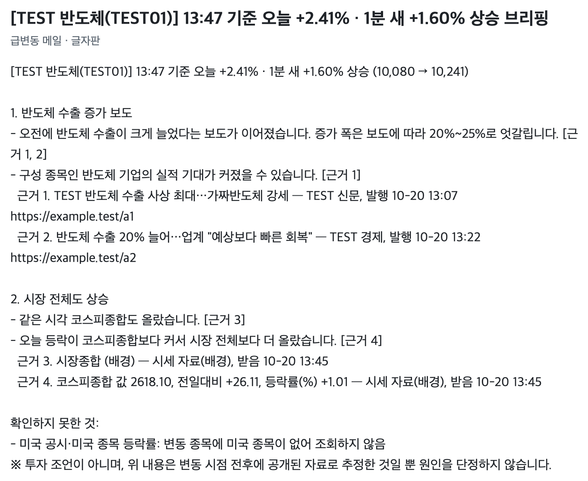
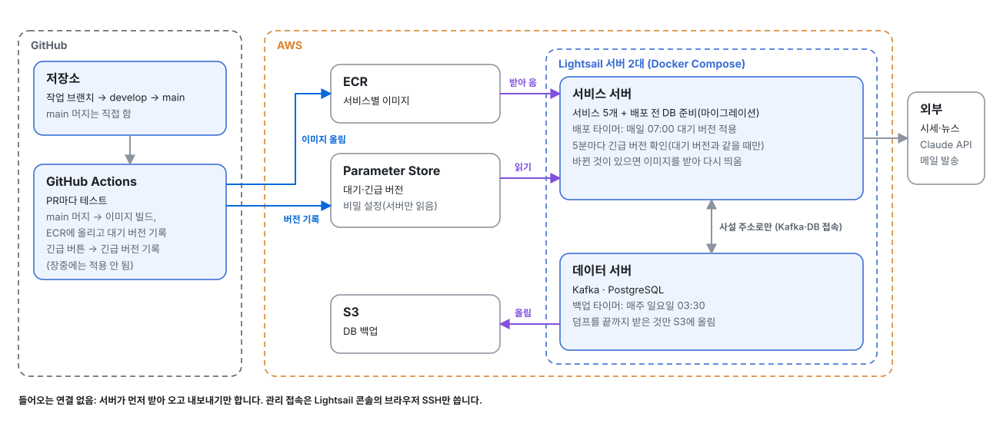
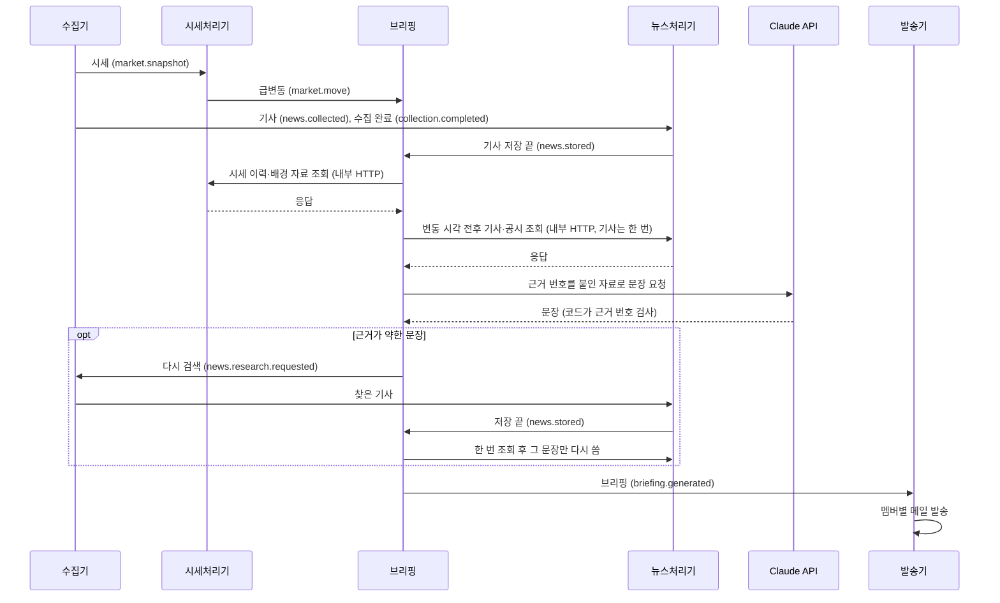
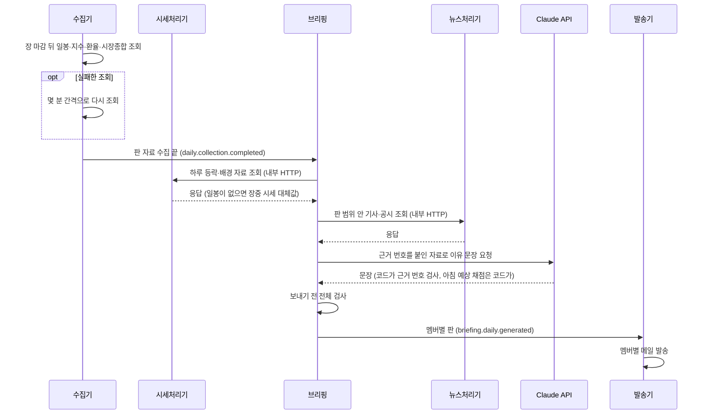

# stock-reading

관심 ETF의 가격이 움직인 **이유**를 근거 기사·공시와 함께 정리해 이메일로 알려 주는 서비스입니다.
Kafka 기반 이벤트 구동 MSA와 근거를 인용하는 LLM 브리핑을 직접 설계하고 구현했습니다.

> **상태:** 운영 중. 장중 급변동 메일과 하루 두 번(아침 판·마감 후 판) 데일리 브리핑을 실제 시세·뉴스로 보냅니다.

## 무엇을 해결하나

ETF가 크게 움직이면 '얼마나'는 바로 보이지만, 그 안의 구성 종목과 시장 흐름이 어떻게 움직였고 왜 그랬는지는 알기 어렵습니다.
이 서비스는 변동 직전에 나온 기사·공시·시장 지표를 구성 종목까지 모아 이유를 정리하고, 문장마다 출처를 붙여 메일로 보냅니다.

<table>
<tr>
<th width="50%">장중 급변동 메일</th>
<th width="50%">마감 후 판 (하루 두 번 중 저녁)</th>
</tr>
<tr>
<td valign="top">

</td>
<td valign="top">

</td>
</tr>
</table>

두 메일 모두 실제 작성 코드에 가짜 값(TEST 종목)을 넣어 만들었습니다(`docs/images/mail_figure.sh`).

## 구성

<picture>
  <source media="(prefers-color-scheme: dark)" srcset="docs/images/architecture-dark.svg">
  
</picture>

서비스끼리 일어난 일은 Kafka 이벤트로 알리고, 브리핑이 근거 자료를 물을 때는 시세처리기·뉴스처리기의 내부 조회 API(서버 밖으로 열지 않음)를 직접 부릅니다. 각 서비스는 PostgreSQL에서 자기 스키마를 씁니다. 종목·멤버 같은 업무 데이터는 DB 표가 원본이고, 필요한 서비스만 읽기 전용으로 읽습니다.

### 배포

<picture>
  <source media="(prefers-color-scheme: dark)" srcset="docs/images/deploy-dark.svg">
  
</picture>

서버 두 대를 Docker Compose로 돌립니다. main에 머지하면 이미지가 만들어지고, 서비스 서버가 다음 07:00에 스스로 받아 와 바꿉니다. 급한 수정은 버튼으로 앞당기되 장중에는 적용하지 않습니다. 이유는 [ADR-013](docs/adr/013-lightsail-compose-deploy.md), 절차는 [`infra/deploy/`](infra/deploy/README.md)에 있습니다.

## 어떻게 동작하나

1. **수집:** 수집기가 1초마다 시세를, 주기마다 뉴스·공시·지수·환율을 받아 이벤트로 냅니다. 데일리 판 자료는 실패한 조회만 몇 분 간격으로 다시 받은 뒤 "판 자료 수집 끝"을 알립니다.
2. **감지:** 시세처리기가 짧은 시간의 급변동과 전일 종가 대비 변동을 찾습니다. 한 번 튄 값은 걸러 내고, 같은 종목은 일정 시간 다시 알리지 않습니다.
3. **근거 모으기:** 브리핑이 변동 시각 전후의 기사·공시·배경 자료만 모읍니다. 근거가 약한 문장은 검색어를 만들어 다시 찾습니다. 같은 사건을 다룬 기사는 묶어서 함께 읽게 합니다.
4. **작성·검증:** LLM은 문장만 씁니다. 숫자 계산과 "인용한 근거 번호가 실제 목록에 있는지" 검사는 코드가 합니다. 다시 쓴 문장이 있거나 코드 검사에서 고칠 문제가 나오면 보내기 전에 메일 전체를 한 번 더 검토해 문장끼리 어긋나거나 겹치는 곳을 고칩니다.
5. **발송:** 멤버마다 자기 ETF만 담은 메일을 보냅니다. 인용할 근거가 없으면 급변동 메일은 보내지 않습니다.
6. **추적:** 작업마다 단계별 실행 기록을 남기고, 이벤트와 내부 조회에 같은 추적 ID를 붙여 어느 단계·어느 호출에서 실패했는지 찾을 수 있게 합니다.

급변동 한 건의 순서

마감 후 판 한 번의 순서

## 설계 원칙

- **근거의 시간 범위를 지킨다:** 변동 뒤에 나온 자료로 변동을 설명하지 않습니다(자료마다 범위를 정하고 테스트로 검증).
- **계약은 스키마 파일:** 서비스 간 이벤트와 내부 조회 API의 본문은 언어 중립 JSON Schema(`contracts/events/`)로 정하고 계약 테스트로 지킵니다.
- **안전한 기본값:** 발송은 기본 드라이런, 이벤트는 `eventId`로 멱등 처리, 외부 접속은 받지 않습니다.
- **운영 문제는 판정 기준부터:** 고친 것이 효과가 있었는지 판단할 기준을 측정 전에 정해 두고, 운영 결과로 판정합니다([`docs/incidents/`](docs/incidents/README.md)).

## 기술 스택

| 영역 | 선택 |
|---|---|
| 서비스 | Java 21 · Spring Boot, 브리핑은 Python |
| 서비스 간 통신 | 일어난 일 알리기는 Apache Kafka (KRaft), 근거 조회는 내부 HTTP |
| 저장소 | PostgreSQL |
| 리포트 작성 | Claude API |
| 배포 | AWS Lightsail · ECR · Terraform · Docker Compose |
| CI/CD | GitHub Actions (테스트, 이미지 빌드, 정해진 시각 자동 배포) |

## 로드맵

- [x] 실제 시세·뉴스·미국 공시 연동
- [x] 급변동 근거 브리핑과 근거 재검색
- [x] 데일리 브리핑 (아침 예상 → 마감 후 대조)
- [x] 클라우드 배포와 CI/CD
- [x] 근거 조회를 Kafka 요청·응답에서 내부 HTTP로 정리, 단계별 실행 기록
- [ ] 메일을 변동·이유·차트 먼저 읽히게 다듬기
- [ ] 운영 판정 자동화
- [ ] 근거 검색 개선 (벡터 검색)
- [ ] 개인화 서비스

## 더 보기

로컬 실행: [`docs/local-development.md`](docs/local-development.md) · 기능별 테스트: [`docs/test-map/`](docs/test-map/README.md) · 배경: [`docs/background.md`](docs/background.md) · 운영 문제 기록: [`docs/incidents/`](docs/incidents/README.md) · 설계 결정: [`docs/adr/`](docs/adr/README.md) · 버전별 변경: [Releases](../../releases)

<a href="docs/hypotheses/README.md">검증한 가설</a>:
<!-- hypotheses:start -->
아직 공개할 가설이 없습니다.
<!-- hypotheses:end -->

코드는 읽기용으로 공개합니다. 라이선스를 두지 않으므로 재사용은 허가하지 않습니다.
