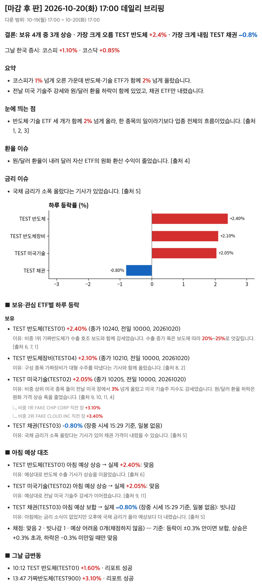
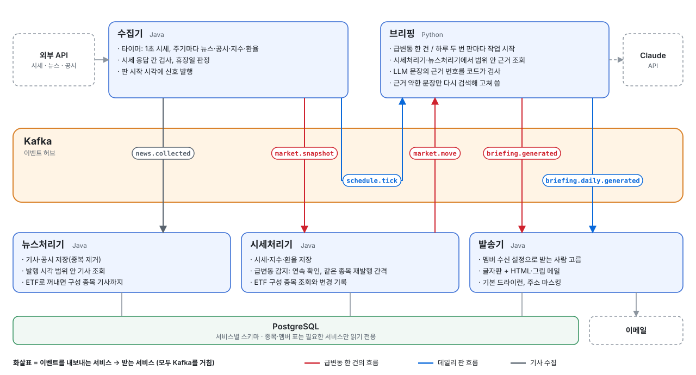
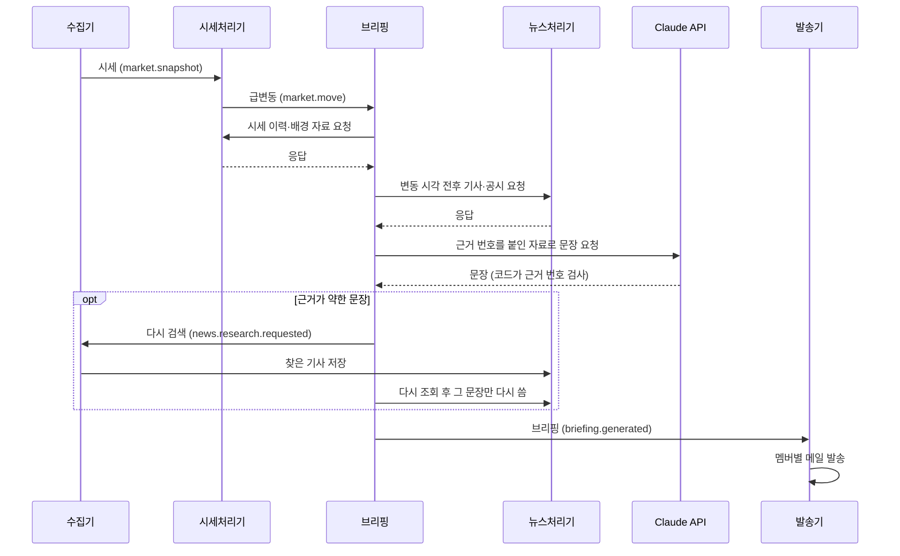

# stock-reading

관심 ETF의 가격이 움직인 **이유**를 근거 기사·공시와 함께 정리해 이메일로 알려 주는 서비스입니다.
Kafka 기반 이벤트 구동 MSA와 근거를 인용하는 LLM 브리핑을 직접 설계하고 구현했습니다.

> **상태:** 운영 중. 장중 급변동 메일과 하루 두 번(아침 판·마감 후 판) 데일리 브리핑을 실제 시세·뉴스로 보냅니다.
> 투자 조언이 아니며, 어떤 매매도 자동으로 하지 않습니다.

## 무엇을 해결하나

가격 알림은 "얼마 올랐다"까지만 알려 줍니다. 이 서비스는 **왜 움직였는지**를 근거 후보와 함께 보여 줍니다. 원인을 단정하지 않고, 근거가 부족하면 부족하다고 씁니다.

  
   마감 후 판 메일 예시(아침 예상 대조·출처 목록 아래는 생략). 실제 작성 코드에 가짜 값을 넣어 만들었습니다.

## 구성

<picture>
  <source media="(prefers-color-scheme: dark)" srcset="docs/images/architecture-dark.svg">
  
</picture>

서비스끼리는 Kafka 이벤트로만 주고받고, 각 서비스는 PostgreSQL에서 자기 스키마를 씁니다. 종목·멤버 같은 업무 데이터는 DB 표가 원본이고, 필요한 서비스만 읽기 전용으로 읽습니다.

## 어떻게 동작하나

1. **수집:** 수집기가 1초마다 시세를, 주기마다 뉴스·공시·지수·환율을 받아 이벤트로 냅니다.
2. **감지:** 시세처리기가 짧은 시간의 급변동과 전일 종가 대비 변동을 찾습니다. 한 번 튄 값은 걸러 내고, 같은 종목은 일정 시간 다시 알리지 않습니다.
3. **근거 모으기:** 브리핑이 변동 시각 전후의 기사·공시·배경 자료만 모읍니다. 근거가 약한 문장은 검색어를 만들어 다시 찾습니다. 같은 사건을 다룬 기사는 묶어서 함께 읽게 합니다.
4. **작성·검증:** LLM은 문장만 씁니다. 숫자 계산과 "인용한 근거 번호가 실제 목록에 있는지" 검사는 코드가 합니다. 다시 쓴 문장이 있거나 코드 검사에서 고칠 문제가 나오면 보내기 전에 메일 전체를 한 번 더 검토해 문장끼리 어긋나거나 겹치는 곳을 고칩니다.
5. **발송:** 멤버마다 자기 ETF만 담은 메일을 보냅니다. 인용할 근거가 없으면 급변동 메일은 보내지 않습니다.

급변동 한 건의 순서

## 설계 원칙

- **근거의 시간 범위를 지킨다:** 변동 뒤에 나온 자료로 변동을 설명하지 않습니다(자료마다 범위를 정하고 테스트로 검증).
- **LLM은 문장만:** 목록 밖 근거를 인용한 출력은 거부하고 다시 씁니다. LLM이 없어도 규칙 기반 본문으로 나갑니다.
- **계약은 스키마 파일:** 서비스 간 이벤트는 언어 중립 JSON Schema(`contracts/events/`)로 정하고 계약 테스트로 지킵니다.
- **안전한 기본값:** 발송은 기본 드라이런, 이벤트는 `eventId`로 멱등 처리, 외부 접속은 받지 않습니다.

## 기술 스택

| 영역 | 선택 |
|---|---|
| 서비스 | Java 21 · Spring Boot, 브리핑은 Python |
| 메시징 | Apache Kafka (KRaft) |
| 저장소 | PostgreSQL |
| 리포트 작성 | Claude API |
| 배포 | AWS Lightsail · ECR · Terraform · Docker Compose |
| CI/CD | GitHub Actions (테스트, 이미지 빌드, 정해진 시각 자동 배포) |

## 설계 결정

| 결정 | 문서 |
|---|---|
| 서비스를 왜, 어떤 기준으로 나눴나 | [ADR-006](docs/adr/006-microservices.md) |
| 왜 Kafka인가 (리플레이·팬아웃·순서) | [ADR-003](docs/adr/003-kafka.md) |
| 이벤트 형식과 호환 규칙 | [ADR-010](docs/adr/010-event-format.md) |
| 외부 접속을 받지 않는 구조 | [ADR-007](docs/adr/007-outbound-only.md) |

전체 목록: [`docs/adr/`](docs/adr/README.md)

## 로드맵

- [x] 실제 시세·뉴스·미국 공시 연동
- [x] 급변동 근거 브리핑과 근거 재검색
- [x] 데일리 브리핑 (아침 예상 → 마감 후 대조)
- [x] 클라우드 배포와 CI/CD
- [ ] 근거 검색 개선 (벡터 검색)
- [ ] 개인화 서비스

## 검증한 가설

구현 전에 증명할 주장을 가설로 등록하고, 판정 기준을 **데이터를 보기 전에** 고정한 뒤 측정합니다([`docs/hypotheses/`](docs/hypotheses/README.md)).

<!-- hypotheses:start -->
아직 공개할 가설이 없습니다.
<!-- hypotheses:end -->

## 더 보기

로컬 실행: [`docs/local-development.md`](docs/local-development.md) · 기능별 테스트: [`docs/test-map/`](docs/test-map/README.md) · 배경: [`docs/background.md`](docs/background.md) · 운영 문제 기록: [`docs/incidents/`](docs/incidents/README.md)

코드는 읽기용으로 공개합니다. 라이선스를 두지 않으므로 재사용은 허가하지 않습니다.
