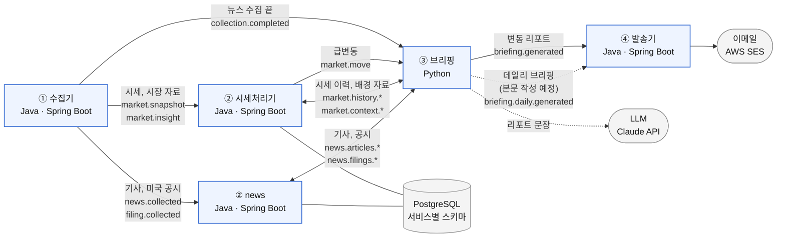

# stock-reading

관심 ETF의 가격이 움직인 **이유**를 근거와 함께 정리해 이메일로 알려 주는 주식 비서입니다.
Kafka 기반 이벤트 구동 MSA와 RAG를 직접 구현하며 배우는 프로젝트입니다.

> **상태:** MVP. 수집 → 변동 감지 → 근거 조회 → LLM 브리핑 → 이메일 흐름이 실제 Kafka·PostgreSQL·LLM에서 끝까지 도는 것을 확인했습니다. 하루 두 번 보내는 데일리 브리핑은 시작 신호와 메일 발송까지 있고, 본문을 만드는 단계는 아직 없습니다.
> 투자 조언이 아니며, 어떤 매매도 자동으로 수행하지 않습니다.

## 무엇을 해결하나

가격 알림은 "얼마 올랐다"까지만 알려 줍니다. 이 프로젝트는 **왜 움직였는지**를 뉴스·공시 같은 근거 후보와 함께 묶어 보여 주는 것을 목표로 합니다. 원인을 단정하지 않고, 근거가 부족하면 부족하다고 말합니다.

## 아키텍처

서비스는 Kafka 이벤트로만 통신합니다. 수집은 `schedule.tick` 이벤트로 시작합니다. 브리핑은 변동 한 건마다 그 변동 이후에 시작한 뉴스 수집이 끝나기를 기다린 뒤, 시세처리기에 시세 이력과 배경 자료(지수, 환율, 시장종합, 일봉, 해외 등락률)를, news 서비스에 기사와 공시를 요청해 근거를 모읍니다. 공시는 변동한 ETF에 담긴 미국 종목의 것만 요청합니다. 끝내 근거를 받지 못하거나 리포트를 만들지 못하면 리포트 없이 이유를 DB에 남깁니다.

## 설계 원칙

- **서비스 간 계약은 JSON Schema 파일**로 두고, v1 샘플로 재현 가능성을 검증합니다 ([ADR-010](docs/adr/010-event-format.md))
- **근거의 시간 범위를 지킵니다.** 기사와 공시는 발행·접수 시각이, 지수·환율 같은 배경 자료는 받은 시각이 자료마다 정한 범위 안인 것만 쓰고, 범위 밖 자료는 버립니다(규칙: [CLAUDE.md](CLAUDE.md)). 기사는 변동 시각 24시간 전부터 변동 직후의 짧은 여유(Δ)까지이며, Δ는 변동 직후에 나온 보도를 담기 위한 여유입니다. 테스트로 검증합니다.
- **LLM은 문장만 씁니다.** 변동률 계산, 인용한 근거 번호가 코드가 준 목록에 있는지 검증, 머리말과 "투자 조언이 아님" 문구는 코드가 맡습니다. 원인을 단정하지 않고, 근거가 부족하면 부족하다고 씁니다. LLM 키가 없으면 규칙 기반 리포트를 만듭니다.
- **안전한 기본값.** 발송기는 드라이런이 기본이고, 시간당 한도·중복 방지·주소 마스킹을 둡니다
- **토픽은 서비스가 선언**하고 브로커 자동 생성은 끕니다. 시작 순서와 무관하게 동작합니다
- **비밀과 개인정보는 저장소에 두지 않습니다.** 설정은 AWS Parameter Store에서 가져옵니다

## 기술 스택

| 영역 | 선택 |
|---|---|
| 서비스 | Java 21 · Spring Boot, 브리핑은 Python |
| 메시징 | Apache Kafka (KRaft) |
| 저장소 | PostgreSQL (pgvector 예정) |
| 리포트 작성 | Claude API (키가 없으면 규칙 기반) |
| 알림 | AWS SES |
| CI | GitHub Actions (테스트와 테스트 지도 검사) |
| 빌드 | Gradle 멀티 모듈 |

## 로드맵

- [x] 실제 시세·뉴스·미국 공시 연동 (국내 공시는 조회 클라이언트까지)
- [x] 근거 조회와 LLM 브리핑
- [ ] 데일리 브리핑 (시작 신호와 메일 발송까지, 본문 작성 전)
- [ ] RAG 기반 근거 검색
- [ ] 개인화 서비스
- [ ] 클라우드 배포와 CI/CD (PR 테스트 CI까지)

## 검증한 가설

구현 전에 증명해야 할 주장을 가설로 등록하고, 판정 기준을 **데이터를 보기 전에** 고정한 뒤 측정합니다. 아래 표는 [`docs/hypotheses/`](docs/hypotheses/README.md)의 정의와 실행 결과에서 자동 생성됩니다. 판정 기준이 완성되지 않은 가설은 표시하지 않습니다.

<!-- hypotheses:start -->
아직 공개할 가설이 없습니다.
<!-- hypotheses:end -->

## 문서

설계 결정과 근거: [`docs/adr/`](docs/adr/README.md) · 가설 검증: [`docs/hypotheses/`](docs/hypotheses/README.md) · 로컬 실행: [`docs/local-development.md`](docs/local-development.md) · 기능별 테스트: [`docs/test-map/`](docs/test-map/README.md)
