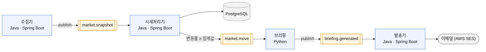

# stock-reading

관심 ETF의 가격이 움직인 **이유**를 근거와 함께 정리해 이메일로 알려 주는 주식 비서입니다.
Kafka 기반 이벤트 구동 MSA와 RAG를 직접 구현하며 배우는 프로젝트입니다.

> **상태:** MVP. 가짜 데이터로 수집 → 변동 감지 → 브리핑 → 이메일까지 로컬에서 동작합니다.
> 투자 조언이 아니며, 어떤 매매도 자동으로 수행하지 않습니다.

## 무엇을 해결하나

가격 알림은 "얼마 올랐다"까지만 알려 줍니다. 이 프로젝트는 **왜 움직였는지**를 뉴스·공시 같은 근거 후보와 함께 묶어 보여 주는 것을 목표로 합니다. 원인을 단정하지 않고, 근거가 부족하면 부족하다고 말합니다.

## 아키텍처

서비스는 Kafka 이벤트로만 통신합니다. 수집은 `schedule.tick` 이벤트로 시작합니다.

## 설계 원칙

- **서비스 간 계약은 JSON Schema 파일**로 두고, v1 샘플로 재현 가능성을 검증합니다 ([ADR-010](docs/adr/010-event-format.md))
- **인과 순서를 지킵니다.** 변동 시각 이후에 나온 뉴스는 원인 근거로 쓰지 않습니다. 테스트로 검증합니다.
- **안전한 기본값.** 발송기는 드라이런이 기본이고, 시간당 한도·중복 방지·주소 마스킹을 둡니다 ([ADR-014](docs/adr/014-notifier-safety-rules.md))
- **토픽은 서비스가 선언**하고 브로커 자동 생성은 끕니다. 시작 순서와 무관하게 동작합니다 ([ADR-013](docs/adr/013-topic-declaration.md))
- **비밀과 개인정보는 저장소에 두지 않습니다.** 설정은 AWS Parameter Store에서 가져옵니다 ([ADR-015](docs/adr/015-parameter-store.md))

## 기술 스택

| 영역 | 선택 |
|---|---|
| 서비스 | Java 21 · Spring Boot, 브리핑은 Python |
| 메시징 | Apache Kafka (KRaft) |
| 저장소 | PostgreSQL (pgvector 예정) |
| 알림 | AWS SES |
| 빌드 | Gradle 멀티 모듈 |

## 로드맵

- [x] 로컬 end-to-end MVP (가짜 데이터)
- [ ] 실제 시세·뉴스·공시 연동
- [ ] RAG 기반 근거 검색
- [ ] 개인화 서비스
- [ ] 클라우드 배포와 CI/CD

## 문서

설계 결정과 근거: [`docs/adr/`](docs/adr/README.md) · 로컬 실행: [`docs/local-development.md`](docs/local-development.md)
